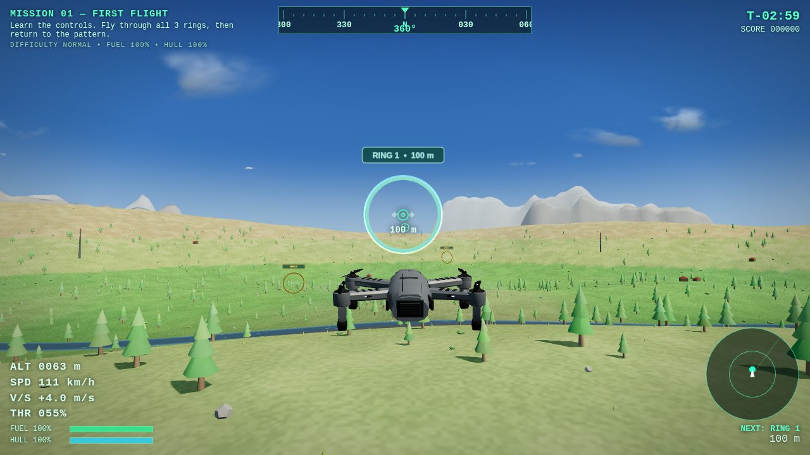
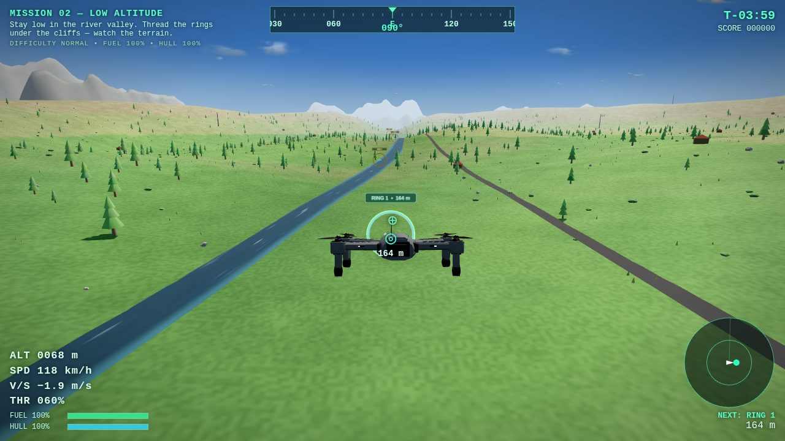
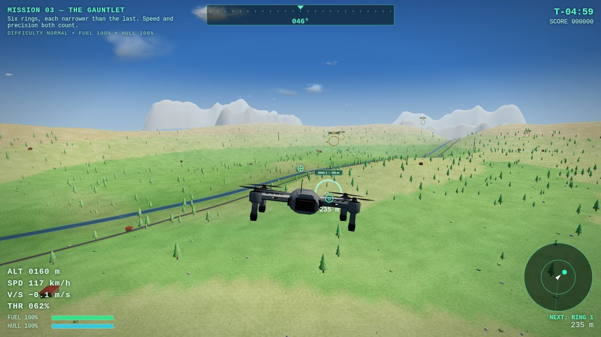
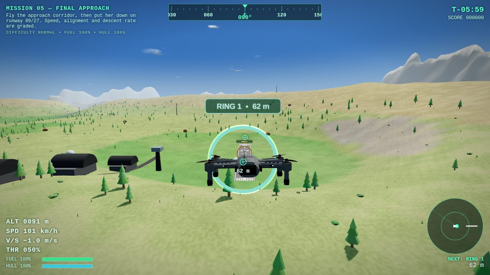

# OPERATION SKY HUNTER

[](https://make.fun/bounty/best-flight-game-20261126-0057?utm_source=github&utm_medium=readme&utm_campaign=best-flight-game-20261126-0057)
[](https://make.fun/bounty/best-flight-game-20261126-0057/leaderboard?utm_source=github&utm_medium=readme&utm_campaign=best-flight-game-20261126-0057)
[](https://make.fun/bounty/best-flight-game-20261126-0057?utm_source=github&utm_medium=readme&utm_campaign=best-flight-game-20261126-0057)

A 3D military drone flight game built with Three.js. Fly a military UAV through target rings across 5 missions, 3 difficulty levels, and 2 flyable aircraft — a quadcopter and a fixed-wing drone — over procedural terrain with mountains, forests, rivers, and dynamic skies.

Built for the [make.fun "best flight game" bounty](https://make.fun/bounty/best-flight-game-20261126-0057).



## Play

Serve the `game/` folder with any static server and open `index.html`:

```bash
cd game
python3 -m http.server 8000
# open http://localhost:8000
```

No build step — the game runs straight from the files. Three.js 0.152.2 is vendored in `game/vendor/`.

## Controls

| Key | Action |
| --- | --- |
| W / S | Pitch (arrow keys work too) |
| A / D | Roll |
| Q / E | Yaw |
| Shift | Boost |
| Ctrl | Slow |
| Space | Stabilize |
| C | Camera: chase / FPV first-person |
| V | Switch aircraft |
| T | Time of day: Clear Day / Golden Hour / Overcast |
| Esc | Pause |

In FPV, the spinning front propellers stay visible at the edges of the frame, like real FPV quad footage.

## Aircraft

- **SKY HUNTER QUAD** (default) — quadcopter with four spinning rotors and a nose sensor gimbal.
- **SKY HUNTER** — fixed-wing military UAV with a pusher prop, sensor gimbal, and landing gear.

Pick your aircraft from the menu or switch mid-flight with V.

## Missions

1. **First Flight** — learn the controls, fly through all 3 rings, return to the pattern.
2. **Low Altitude** — stay low through the rings.
3. **The Gauntlet** — a tight ring course.
4. **High Altitude** — thin air, long sightlines.
5. **Final Approach** — land on the runway; the landing is graded S / A / B / C.

Each mission tracks fuel and hull, with a compass, radar, ring guidance, and a mission timer on the military HUD.

## Difficulty

**Easy / Normal / Hard.** Difficulty changes the flight model, ring size, timers, fuel, wind, and landing tolerances — not just the numbers on the HUD.

## Tech

- Three.js 0.152.2 (vendored UMD build, no CDN dependency at runtime)
- Procedural terrain, ridged mountain ranges, and shader clouds — no heightmap downloads
- Aircraft are GLB models (`game/assets/drone.glb`, `game/assets/quad.glb`) loaded by a hand-written minimal GLB parser
- Procedural WebAudio engine sound — no audio files
- Deterministic screenshot mode: open `index.html?shot=cover|flight|gauntlet|runway` for a staged autopilot shot

## Screenshots




